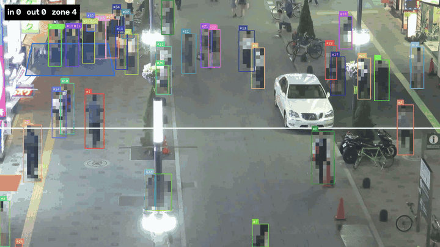
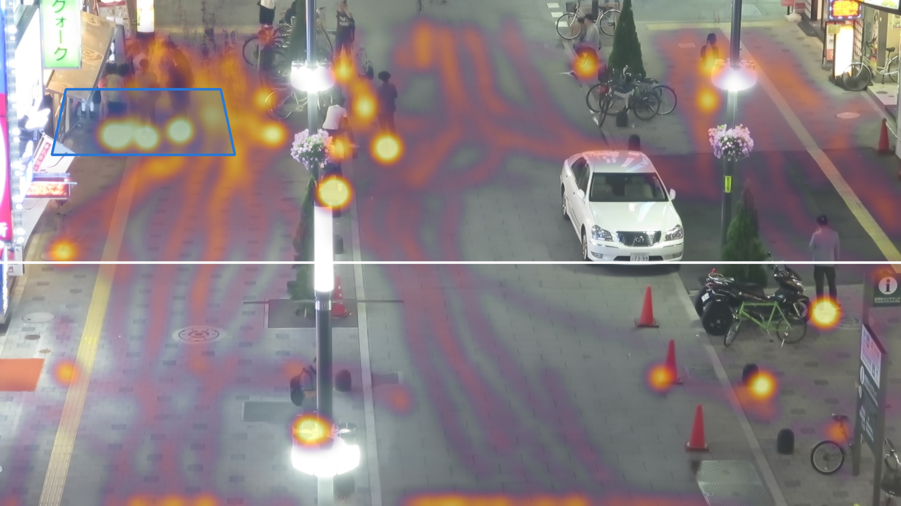

# people-crowd-dwell-analytics

Detect people in video, track them over time and turn the tracks into audience KPIs: line crossings with direction, dwell time in a zone (e.g. in front of a display) and a heatmap of where people stand.



**Pipeline:** YOLO (`person`) → ByteTrack → line / polygon zone → per-track KPIs → aggregation, with tracker quality measured against MOT17 ground truth (MOTA / IDF1).

## Quickstart

Requires macOS on Apple Silicon (MPS / CoreML), [uv](https://docs.astral.sh/uv/) and `ffmpeg` for the GIF.

```bash
make setup                 # uv env, Python 3.12, incl. coremltools
make data                  # MOT17 (~5.5 GB), extracts the FRCNN train sequences
make preview SEQ=MOT17-04  # check line and zone from configs/zones.yaml
make track analyze eval SEQ=MOT17-04
make bench                 # FPS per model size and backend
make gif
```

Any video file works as input:

```bash
uv run crowd-track my_video.mp4 --scene MY_SCENE --out runs/my_video
uv run crowd-analyze runs/my_video
```

## Outputs per run

| File | Content |
|---|---|
| `annotated.mp4` | boxes, IDs, traces, line, zone, live counter, people pixelated |
| `tracks.csv` | one row per frame and track: box, confidence, in-zone flag, crossing (+1 in / −1 out) |
| `tracks_stitched.csv` | tracks after gap stitching |
| `track_kpis.csv` | per track: first/last seen, dwell time, path length, crossings |
| `throughput.csv`, `throughput.png` | crossings per minute over time |
| `dwell_hist.png` | dwell time distribution |
| `heatmap.png` | foot-point density over a person-free background |
| `summary.json`, `meta.json` | headline KPIs, run config and throughput |

## Method

- **Detection & tracking:** Ultralytics YOLO restricted to class `person`, ByteTrack with a low detection threshold (`conf=0.1`) so its second association stage can recover occluded people.
- **Geometry:** the bottom-centre of each box (foot point) triggers the line and the zone, so a person counts where they stand, not where their head is.
- **Gap stitching:** occlusions split one person into several IDs and cut dwell times short. A track starting within `--max-gap` seconds and `--max-dist` pixels of where another ended is merged into it (greedy, nearest first).
- **Evaluation:** MOTA and IDF1 follow the MOTChallenge / TrackEval protocol: predictions matched to distractor classes (static person, reflection, …) are dropped, only non-ignored pedestrians count as ground truth, IoU ≥ 0.5.

## Results

**Tracking quality** on MOT17-04 (1050 frames, 30 fps), ByteTrack, COCO-pretrained detector without fine-tuning:

| Detector | Input | Tracks | MOTA | IDF1 | IDSW | Recall | Precision |
|---|---|---|---|---|---|---|---|
| YOLO26s | 960 | raw | 44.3 | 54.9 | 66 | 49.0 | 91.5 |
| YOLO26s | 960 | stitched | 44.3 | 56.0 | 51 | 49.0 | 91.5 |
| YOLO26s | 1280 | raw | 51.7 | 59.2 | 112 | 61.2 | 86.9 |
| YOLO26s | 1280 | stitched | 51.8 | 61.7 | 85 | 61.2 | 86.9 |
| YOLO26m | 1280 | raw | 53.8 | 60.0 | 108 | 63.3 | 87.3 |
| YOLO26m | 1280 | stitched | **53.9** | **62.9** | 68 | 63.3 | 87.3 |

- Recall is the bottleneck: most misses are small, distant pedestrians. Input resolution matters more than model size (+7.4 MOTA from 960 → 1280, +2.1 from s → m).
- Gap stitching changes only identities, so MOTA barely moves, but it cuts ID switches by 23–37 % and lifts IDF1 by up to 2.9 points. IDF1 is the metric that matters for dwell time.

**Throughput** on MacBook M5, detection + tracking end to end:

| Model | MPS | CoreML FP32 | CoreML FP16 |
|---|---|---|---|
| YOLO26n | – | – | – |
| YOLO26s | – | – | – |
| YOLO26m | – | – | – |



## Privacy by design

- Stored: anonymous track IDs, bounding boxes, timestamps, zone flags. No crops, embeddings or face data.
- The heatmap background is the per-pixel median over sampled frames, which removes moving people.
- The annotated video pixelates every detected person by default (`--no-anonymize` for debugging only).
- Own recordings only without identifiable people or with consent.

## Data & license

- [MOT17](https://motchallenge.net/data/MOT17/) is licensed CC BY-NC-SA 3.0; it is downloaded, not redistributed.
- This repository is licensed under AGPL-3.0, matching [Ultralytics](https://github.com/ultralytics/ultralytics) (AGPL-3.0), which it depends on.
