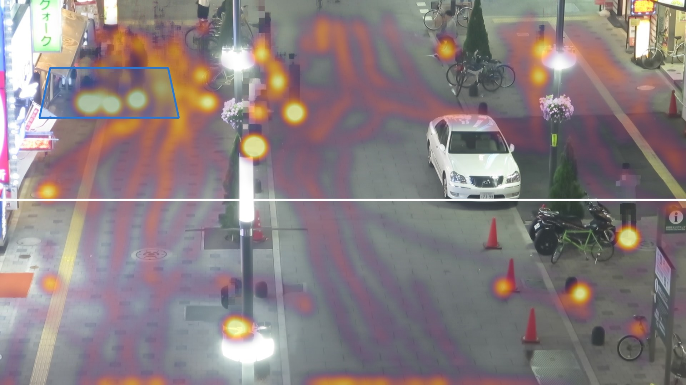
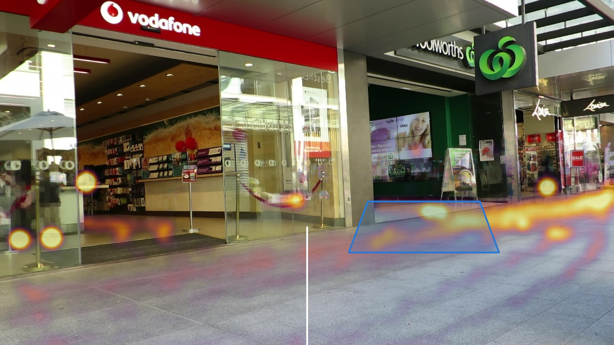
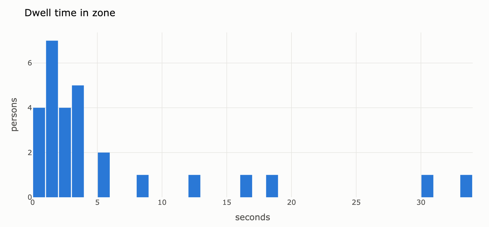
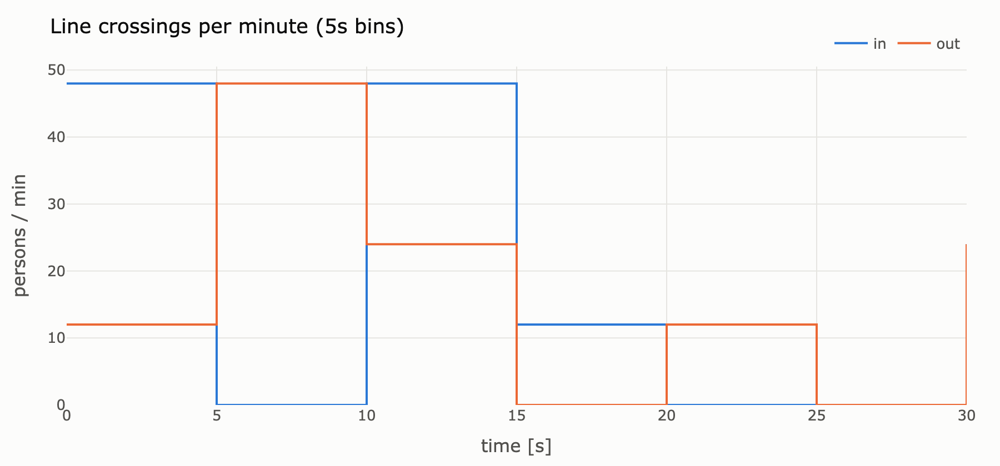
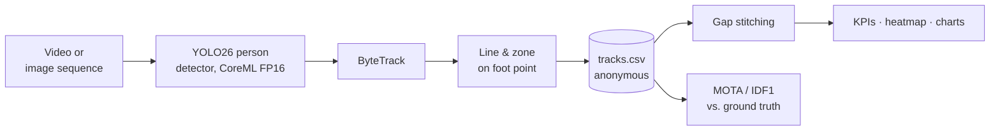

# People Counting & Dwell-Time Analytics

Detect people in video, track them over time and turn the tracks into audience KPIs for retail and digital signage: **line crossings with direction, dwell time in front of a display, and a heatmap of where people stand**. Runs in real time on a MacBook via CoreML; only anonymous tracks are stored.


<sub>MOT17-04 · YOLO26s (CoreML FP16) + ByteTrack · people pixelated by default · live counters for line and zone</sub>

## Highlights

- **Real time on Apple Silicon:** 44.7 fps end to end (detection + tracking, 1280 px) with a CoreML FP16 export on the Neural Engine, 1.7× faster than PyTorch MPS.
- **Measured, not eyeballed:** MOTA / IDF1 against MOT17 ground truth on two scenes, using the TrackEval protocol implemented from scratch.
- **Identity matters for dwell time:** gap stitching cuts ID switches by up to 37 % and adds up to 3.3 IDF1 points at zero detector cost.
- **Privacy by design:** stored output is IDs, boxes and timestamps. Video and heatmap backgrounds are pixelated.

## What it measures

<table>
<tr>
<td width="50%"></td>
<td width="50%"></td>
</tr>
<tr>
<td><b>Pedestrian street (MOT17-04).</b> Zone at the shop front: 28 visitors, median dwell 2.5 s, P90 16.9 s. Bright spots are people who stay put: a steward, two seated people and a group at the shop window.</td>
<td><b>Shop entrances (MOT17-09).</b> Zone in front of the video wall: 19 of 62 passers-by enter it, median 2.0 s, P90 3.2 s. The screen is passed, not watched.</td>
</tr>
</table>

<table>
<tr>
<td width="50%"></td>
<td width="50%"></td>
</tr>
</table>

Per track: first/last seen, dwell time in the zone, path length, line crossings (in/out). Aggregated: persons and crossings per time bin, dwell distribution, foot-point heatmap.

## How it works



- **Detection & tracking:** Ultralytics YOLO restricted to `person`, ByteTrack with a low detection threshold (`conf=0.1`) so its second association stage can recover partly occluded people. Frames are decoded in a thread pool so the detector never waits for JPEG decoding.
- **Geometry:** the bottom centre of each box (foot point) triggers line and zone, so people count where they stand rather than where their head is in the image.
- **Gap stitching:** occlusion splits one person into several IDs and cuts dwell times short. A track that starts within 1 s and 80 px of where another ended continues that identity (greedy, nearest first).
- **Evaluation:** CLEAR MOT and identity metrics as in TrackEval. Predictions matched to distractor classes (static person, reflection, person on vehicle) are ignored, only active pedestrians count as ground truth, IoU ≥ 0.5.

## Results

### Tracking quality

COCO-pretrained detectors without fine-tuning, ByteTrack, MOT17 train sequences. Arrows show raw tracks → after gap stitching.

| Scene | Detector | Input | MOTA | IDF1 | ID switches | Recall | Precision |
|---|---|---|---|---|---|---|---|
| MOT17-04 | YOLO26s | 960 | 44.3 | 54.9 → 56.0 | 66 → 51 | 49.0 | 91.5 |
| MOT17-04 | YOLO26s | 1280 | 51.8 | 59.2 → 61.7 | 112 → 85 | 61.2 | 86.9 |
| MOT17-04 | YOLO26m | 1280 | **53.9** | 60.0 → **62.9** | 108 → 68 | 63.3 | 87.3 |
| MOT17-04 | YOLO26s CoreML FP16 | 1280 | 51.8 | 58.4 → 60.6 | 112 → 80 | 61.3 | 86.8 |
| MOT17-09 | YOLO26s CoreML FP16 | 1280 | 56.9 | 49.6 → 52.9 | 52 → 46 | 74.2 | 81.8 |

### Throughput on MacBook M5

End-to-end FPS for detection + tracking, 1280×736 input, median over 300 frames after warm-up.

| Model | PyTorch MPS | CoreML FP32 | CoreML FP16 |
|---|---|---|---|
| YOLO26n | 43.4 | 22.9 | **54.2** |
| YOLO26s | 26.7 | 10.3 | **44.7** |
| YOLO26m | 11.3 | 4.0 | **27.0** |

### Findings

1. **Recall is the bottleneck, and resolution beats model size.** Most misses on MOT17-04 are small, distant pedestrians. Going from 960 to 1280 px adds 7.5 MOTA, going from s to m only 2.1.
2. **FP16 is what unlocks the Neural Engine.** The FP32 CoreML export runs on GPU/CPU and is slower than PyTorch MPS. FP16 is 1.7–2.4× faster than MPS and matches its MOTA. It costs about one IDF1 point, because small box deviations occasionally flip a long-lived identity.
3. **MPS timings are misleading per stage.** PyTorch MPS runs asynchronously: "inference" covers only kernel dispatch, and the GPU wait shows up in post-processing. Only end-to-end frame time is comparable across backends.
4. **Stitching fixes identities, not detections.** MOTA barely moves, but IDF1, the metric that decides whether a dwell time belongs to one person, rises by 1.1–3.3 points.
5. **A plausible fix that did not work.** Dropping static low-confidence tracks looked like a way to remove false positives. Evaluation showed it removed about as many true as false positives (FP −384, FN +330), and the "static false positives" in the heatmap turned out to be real people. It was dropped.

## Privacy by design

| Stored | Not stored |
|---|---|
| anonymous track IDs, boxes, timestamps, zone and line events | face crops, appearance embeddings, re-identification features |
| aggregated KPIs and charts | unpixelated video |
| heatmap over a median background with people pixelated | any mapping from track ID to a person |

- The annotated video pixelates every detected person by default (`--no-anonymize` exists for debugging only).
- The heatmap background is the per-pixel median of frames in which detected people are already pixelated, so neither passers-by nor people standing still are recognisable.
- Own recordings only without identifiable people or with consent.

## Quickstart

Requires macOS on Apple Silicon, [uv](https://docs.astral.sh/uv/) and `ffmpeg`.

```bash
make setup                                   # Python 3.12 env incl. coremltools
make data                                    # MOT17 (~5.5 GB), FRCNN train sequences
make export                                  # YOLO26s -> CoreML FP16
make preview SEQ=MOT17-04                    # check line and zone from configs/zones.yaml
make track analyze eval SEQ=MOT17-04 MODEL=yolo26s.mlpackage
make bench                                   # FPS table
```

Any video works as input. Add a scene with a line and a polygon to `configs/zones.yaml`, then:

```bash
uv run crowd-track my_video.mp4 --scene MY_SCENE --model yolo26s.mlpackage --out runs/my_video
uv run crowd-analyze runs/my_video
```

<details>
<summary>Outputs per run</summary>

| File | Content |
|---|---|
| `annotated.mp4` | boxes, IDs, traces, line, zone, live counters, people pixelated |
| `tracks.csv` | one row per frame and track: box, confidence, in-zone flag, crossing (+1 in / −1 out) |
| `tracks_stitched.csv` | tracks after gap stitching |
| `track_kpis.csv` | per track: first/last seen, dwell time, path length, crossings |
| `throughput.csv` / `.png` | persons and crossings per time bin |
| `dwell_hist.png` | dwell-time distribution |
| `heatmap.jpg` | foot-point density over the pixelated median background |
| `summary.json`, `meta.json` | headline KPIs, run configuration and throughput |

</details>

<details>
<summary>Repository layout</summary>

```
src/crowd_dwell/
  detect_track.py   video in -> tracks.csv, annotated video, background
  zones.py          scene geometry, frame reader, zone preview
  analytics.py      gap stitching, per-track KPIs, heatmap, charts
  evaluate.py       MOTA / IDF1 (TrackEval protocol)
  benchmark.py      FPS per model and backend
configs/zones.yaml  line and zone per scene
tests/              metric and analytics unit tests
```

</details>

## Limitations

- The detector is COCO-pretrained and not fine-tuned on pedestrians. Fine-tuning on MOT17 train would leak into this evaluation, and MOT17 test needs a server submission.
- The sequences are 17–35 s long, so per-minute rates are extrapolated and dwell distributions are small samples.
- Dwell time measures presence in a zone, not attention. Head-pose estimation ("who looks at the display?") is a natural next step.
- Single camera, no re-identification across cameras or visits, by design.

## Data & license

- [MOT17](https://motchallenge.net/data/MOT17/) (Milan et al., *MOT16: A Benchmark for Multi-Object Tracking*, arXiv:1603.00831) is licensed CC BY-NC-SA 3.0. The dataset is downloaded, not included. The GIF and heatmaps in `assets/` are derived from it and shared under the same license.
- Code is licensed under AGPL-3.0, matching [Ultralytics](https://github.com/ultralytics/ultralytics), which it depends on.
